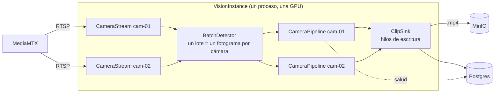
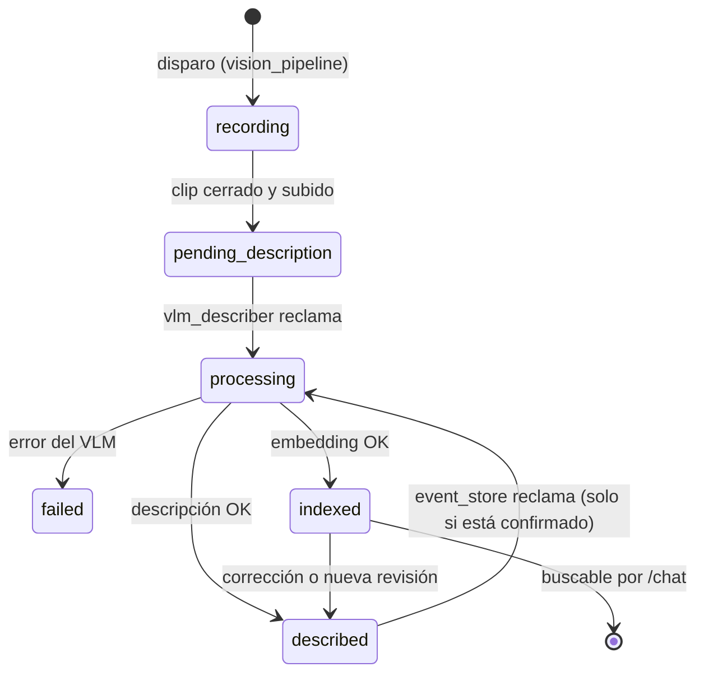

# Arquitectura del sistema

## Decisiones de infraestructura

- **Los componentes con GPU corren nativos, sin Docker.** YOLO, ByteTrack y el VLM necesitan CUDA
  directo; un contenedor agrega fricción de drivers sin aportar nada. Postgres, MinIO y MediaMTX sí
  corren en Docker: no usan la GPU.
- **Postgres es la columna vertebral.** La tabla `events` hace de metadatos del evento, de **cola de
  trabajo** entre procesos (columna `status`, reclamada con `FOR UPDATE SKIP LOCKED`) y de **fuente de
  cambios** para las alertas en tiempo real (`updated_at`). No hace falta un broker de mensajes.
- **Búsqueda híbrida sin base vectorial aparte.** Texto nativo de Postgres (`search_vector`,
  `tsvector`) y pgvector (`embedding vector(1024)`, distancia coseno) combinados con Reciprocal Rank
  Fusion, en la misma fila del evento. Ver `event_store/hybrid_search.py`.
- **Clips cortos por evento, no grabación continua.** Cada evento produce un `.mp4` autocontenido con
  los segundos previos al disparo (buffer circular en memoria) y 30 s posteriores.
- **Clips en MinIO.** `clip_path` es la clave del objeto en el bucket (`<camera_id>/<event_id>.mp4`).
  `query_service` no sirve los bytes: devuelve una URL prefirmada (`GET /clip-url/{path}` o
  redirección en `GET /clips/{path}`).
- **Las cámaras pasan por MediaMTX.** MediaMTX republica cada cámara por RTSP (para el análisis) y por
  HLS (para la interfaz), y valida cada conexión contra la API (`POST /auth/mediamtx`).
- **Varias cámaras por proceso de visión.** Cada instancia de visión (`vision_pipeline/instance.py`)
  atiende un grupo fijo de cámaras (`config/instances.yaml`) con un solo detector en una GPU. La
  asignación es estática: una cámara pertenece a una sola instancia.
- **Nada se indexa sin la confirmación de un operador.** La descripción la escribe un modelo que no es
  del todo fiable, así que ningún evento, ni siquiera una alerta, queda consultable por `/chat` hasta
  que una persona lo revisa y lo confirma.

## Módulo 1: la instancia de visión



- **`CameraStream`**: captura cada cámara en su hilo, comprime el fotograma y calcula las señales de
  salud en ese mismo hilo, y lo deja en una cola acotada que descarta lo más viejo si se llena.
  Reconecta sola si la cámara se corta.
- **`BatchDetector`**: un hilo y un modelo para todas las cámaras; arma lotes con un fotograma por
  cámara, en turnos rotativos, para que ninguna acapare el detector.
- **`CameraPipeline`**: estado de cada cámara: buffer previo, salud, seguimiento (ByteTrack), reglas
  de disparo y clips abiertos.
- **`ClipSink`**: codifica, sube a MinIO y registra el evento fuera del hilo del detector.

### Reglas de disparo (`vision_pipeline/event_trigger.py`)

| Regla | Motivo | Alerta | Cuándo dispara |
|---|---|---|---|
| `DirectIncidentRule` | `fire`, `accident` | Sí | Detecciones de la clase con la confianza de alerta, sostenidas durante la persistencia mínima de la clase dentro de una ventana, o una sola detección muy segura. Los choques entran sin pasar por el seguimiento, porque el detector los da en ráfagas de pocos fotogramas. |
| `ReviewIncidentRule` | `posible_choque` | No | Evidencia más débil de choque en la ventana. Espera unos segundos: si el mismo incidente sale como alerta, no se abre. |
| `PersonAltercationRule` | `posible_altercado` | No | Dos personas cercanas y agitadas durante varios segundos seguidos. |

Las reglas se expresan en segundos, así que no dependen de los fps de análisis. Los incidentes se
deduplican por cámara dentro de una ventana (`event_dedup_window_seconds`).

### Salud de cámara

`CameraHealthMonitor` detecta `tapada` (imagen negra, uniforme o sin nitidez) y `corte_de_señal`
(reconexión fallida sostenida), y la recuperación (`ok`). **No es un evento** (RF10): se guarda en las
columnas `health_*` de `cameras`, sin clips ni filas en `events`. Una cámara figura `corte_de_señal`
desde que arranca su instancia hasta que se conecta. La instancia renueva además un latido
(`analysis_heartbeat_at`); si deja de renovarse, la cámara figura `sin_analisis`, un estado que nadie
escribe y que se deriva al leer. `GET /cameras/health` devuelve el estado y `WS /camera-status`
manda el estado de cada cámara al conectarse y después cada cambio.

## Flujo de un evento, de punta a punta

```mermaid
sequenceDiagram
    participant Cam as Cámara
    participant VP as vision_pipeline
    participant DB as Postgres (events)
    participant QS as query_service
    participant UI as Interfaz
    participant VD as vlm_describer
    participant ES as event_store
    participant Op as Operador

    Cam->>VP: fotogramas (vía MediaMTX)
    VP->>VP: YOLO + ByteTrack + reglas de disparo
    VP->>DB: INSERT status=recording (en el instante del disparo)
    QS->>DB: polling cada 1 s (updated_at)
    QS-->>UI: WS /alerts: alerta, una sola vez por evento<br/>(solo fire, accident; sin descripción todavía)
    VP->>VP: graba 30 s más y cierra el clip
    VP->>DB: sube el .mp4 a MinIO, UPDATE status=pending_description
    VD->>DB: reclama pending_description -> processing
    VD->>VD: describe con Qwen2-VL (fotogramas alrededor del disparo)
    VD->>DB: UPDATE status=described, description_nl=...
    Op->>UI: revisa: descripción, categoría, vehículos
    UI->>QS: POST /events/{id}/details
    QS->>DB: review_status=confirmed, vehículos, reviewed_by=operador
    ES->>DB: reclama described y confirmado -> processing
    ES->>DB: UPDATE status=indexed, embedding=...
    Op->>UI: «¿hubo un choque en Independencia?»
    UI->>QS: POST /chat
    QS->>DB: búsqueda híbrida sobre eventos confirmados
    QS-->>UI: respuesta + eventos citados (clip_path)
    UI->>QS: GET /clip-url/{clip_path}
    QS-->>UI: URL prefirmada de MinIO
```

## Revisión de un evento

Una alerta se puede revisar desde el tablero (panel sobre el chat) o desde la vista de Revisión, que
lista todos los eventos descritos sin confirmar (`GET /events/pending-review`).

- **Confirmar:** `POST /events/{id}/details` con la descripción final, la categoría (opcional) y, en
  un choque, los vehículos (al menos uno). Es la única forma de confirmar. Si el texto cambió,
  `description_nl_original` conserva lo que escribió el VLM y `description_edited` queda en `true`.
  El evento vuelve a `described` confirmado, y `event_store` lo indexa en el siguiente ciclo.
- **Cambiar la categoría:** `POST /events/{id}/category`; conserva la original en
  `trigger_reason_original`.
- **Corregir solo el texto:** `POST /events/{id}/description`.
- **Descartar:** `POST /events/{id}/review` con `dismissed`. El evento nunca se indexa.

Si una alerta absorbe a un `posible_choque` previo del mismo incidente (su clip ya incluye esos
segundos), el pendiente se descarta solo.

## Máquina de estados de un evento (columna `status`)



Un evento sin confirmar se queda en `described` indefinidamente: no es que la cola se trabe, es que
todavía no es indexable. Los eventos que un worker reclamó y dejó trabados en `processing` vuelven a
su cola al arrancar el worker y cada cierto tiempo.

## Modelo de datos (ver `common/db.py` y `common/schemas.py`)

### Tabla `events`

| Campo | Tipo | Notas |
|---|---|---|
| `id` | BIGINT identity PK | interno |
| `event_id` | TEXT UNIQUE | UUID, identificador público |
| `camera_id` / `camera_label` | TEXT | referencia a `cameras` |
| `track_id` | INTEGER | identificador del seguimiento que disparó |
| `object_classes` | TEXT (JSON) | clases involucradas |
| `trigger_reason` | TEXT | `fire`, `accident`, `posible_choque`, `posible_altercado` o `fight` (solo por reclasificación) |
| `trigger_reason_original` | TEXT | categoría previa si un operador la cambió |
| `start_ts` / `end_ts` | TIMESTAMP | ventana del clip |
| `clip_path` | TEXT | clave del objeto en MinIO |
| `status` | TEXT | ver máquina de estados |
| `description_nl` | TEXT | descripción del VLM (o la corregida) |
| `attributes` | TEXT (JSON) | atributos estructurados de la descripción |
| `confidence` | DOUBLE PRECISION | confianza del disparo |
| `review_status` / `reviewed_by` | TEXT | `pending`, `confirmed` o `dismissed`, y el operador que revisó |
| `description_nl_original` / `description_edited` | TEXT / BOOLEAN | texto original del VLM y marca de corrección |
| `vehicles` / `vehicles_text` | TEXT | vehículos en JSON y como texto para el índice |
| `created_at` / `updated_at` / `described_at` | TIMESTAMP | `updated_at` es el cursor de las alertas |
| `embedding` | vector(1024) | `intfloat/multilingual-e5-large`; NULL hasta `indexed` |
| `search_vector` | tsvector | generado por trigger desde la descripción, la cámara y los vehículos |

### Tabla `event_vehicles`

Vehículos de un choque cargados por el operador; se reemplazan completos en cada revisión. Clave
`(event_id, position)`, `vehicle_type` (`auto`, `moto`, `camion`, `camioneta` o `pickup`) y `color`
en texto libre normalizado. El chat filtra por tipo y color sobre esta tabla.

### Tabla `cameras`

| Campo | Tipo | Notas |
|---|---|---|
| `camera_id` | TEXT PK | coincide con `config/cameras.yaml` |
| `label` / `source` | TEXT | nombre y URL RTSP republicada |
| `comuna` / `lat` / `lon` / `ubicacion` | | ubicación; `ubicacion` (calles) la usa la consulta |
| `updated_at` | TIMESTAMP | último registro de la cámara |
| `health_status` / `health_since` / `health_updated_at` | | estado de salud, desde cuándo y cursor de `WS /camera-status` |
| `analysis_heartbeat_at` / `analysis_instance` | | latido de la instancia que la analiza |

### Tabla `runtime_config`

Ajustes que se cambian en vivo sin reiniciar (por ejemplo, el umbral de confianza del detector), vía
`GET/POST/DELETE /config/runtime`. Sin fila, rige el valor de `.env`.
