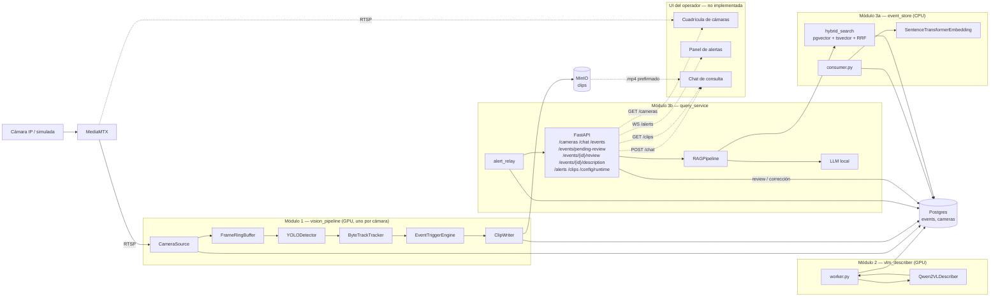
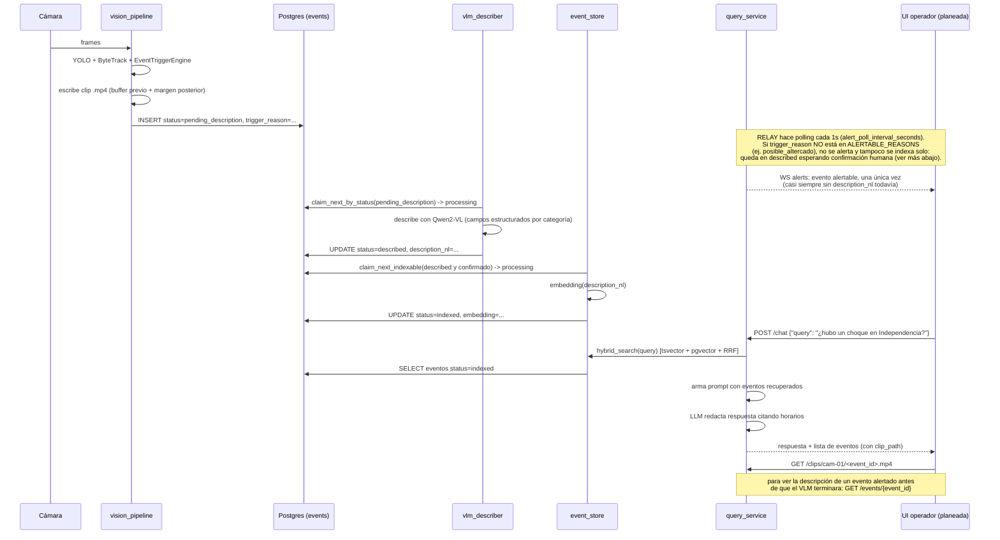
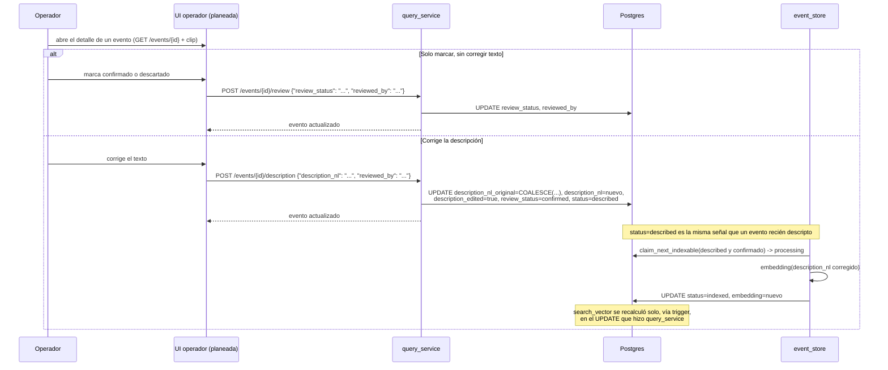
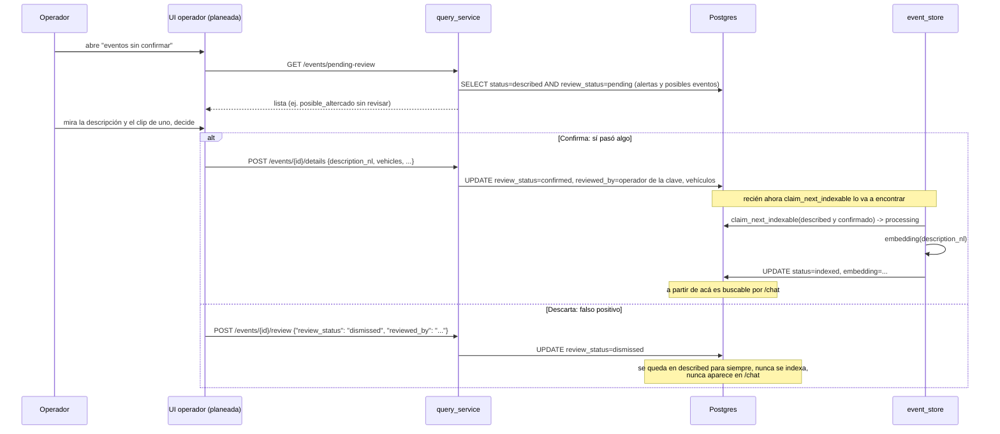
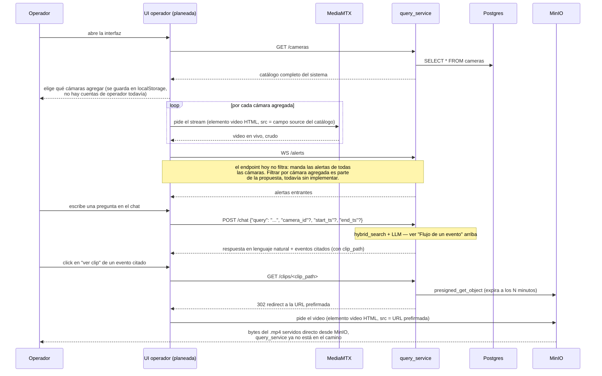

# Arquitectura del sistema

## Decisiones de infraestructura y por qué

- **Los componentes GPU corren nativos, sin Docker.** YOLO, ByteTrack/Re-ID y
  el VLM necesitan CUDA directo — pasar por una capa de contenedor agrega
  fricción de drivers/WSL sin aportar nada. Esto no cambió.
- **Postgres es la columna vertebral, no un detalle de persistencia** (antes
  SQLite — migrado para poder correr los módulos en máquinas distintas, ver
  `PROPUESTA_ARQUITECTURA_DISTRIBUIDA.md` en la carpeta de la tesis). Una
  única tabla (`events`) hace de: (a) metadatos del evento, (b) **cola de
  trabajo** entre procesos vía la columna `status`, y (c) **fuente de
  cambios** para las alertas en tiempo real vía `updated_at`. Nada de esto
  requiere un broker de mensajes aparte. Postgres corre en Docker
  (`docker-compose.yml`) — es CPU-only, no compite por la GPU con los
  componentes de arriba, por eso no aplica la misma razón para evitarlo.
- **Búsqueda híbrida sin servidor de base de datos vectorial aparte.**
  Búsqueda de texto nativa de Postgres (`tsvector`/`to_tsquery`, columna
  `search_vector`) + pgvector (columna `embedding vector(1024)`, distancia
  coseno vía `<=>`) combinados con Reciprocal Rank Fusion, todo con una sola
  consulta a Postgres por lado — antes era un índice FAISS aparte
  (`events.faiss`) que había que mantener sincronizado con la base a mano; con
  pgvector el embedding vive en la misma fila del evento. Ver
  `event_store/hybrid_search.py`.
- **Clips cortos por evento, no grabación continua.** Cada evento produce un
  archivo `.mp4` autocontenido, con contexto previo al disparo gracias a un
  buffer circular en memoria. Evita tener que resolver *seek* dentro de
  archivos largos a esta escala.
- **Clips en MinIO (S3), no en el filesystem local** (antes `data/clips/` —
  migrado por la misma razón que Postgres, ver `PROPUESTA_ARQUITECTURA_DISTRIBUIDA.md`
  §2.2). `clip_path` en la base sigue siendo un string con la misma forma de
  antes (`"cam-01/event-id.mp4"`), solo que ahora es la *object key* dentro
  del bucket, no un path de disco. `query_service` no sirve los bytes
  directo — redirige a una URL prefirmada de MinIO (`GET /clips/{path}`).
  MinIO también corre en Docker, mismo motivo que Postgres.
- **Las cámaras se conectan a través de MediaMTX, no directo a Módulo 1**
  (ver `PROPUESTA_ARQUITECTURA_DISTRIBUIDA.md` §2.4). Antes, Módulo 1 era el
  único consumidor de la cámara; ahora MediaMTX republica el stream por RTSP
  y cualquier cliente puede consumirlo de forma independiente (Módulo 1 hoy,
  la UI del operador el día que exista). `CameraSource` no cambia — sigue
  siendo una URL RTSP en `config/cameras.yaml`, apuntando al path republicado
  en vez de a la cámara directo. Sin cámara IP real todavía,
  `scripts/simulate_ip_camera.py` republica un video de prueba en loop hacia
  MediaMTX para poder probar el camino completo.
- **Catálogo de cámaras autoregistrado, no mantenido a mano.** Cada Módulo 1
  hace upsert de su propia fila en la tabla `cameras` al arrancar (`camera_id`,
  `label`, `source`, `updated_at`), no hay un paso manual de alta aparte de
  agregar la cámara a `config/cameras.yaml`. `GET /cameras` en Módulo 3b
  expone ese catálogo — pensado para que una futura UI de operador sepa qué
  cámaras existen sin necesitar su propia copia de la config.
- **Revisión humana de un evento: marcarlo o corregirlo, y ninguna de las dos
  es obligatoria.** `POST /events/{id}/review` marca `review_status` en
  `confirmed`/`dismissed` sin tocar el texto — un evento puede quedarse en
  `pending` para siempre sin que nada se rompa, no hay ningún paso del
  sistema que dependa de que se lo revise. `POST /events/{id}/description`
  cubre el caso en que la operadora corrige el texto que escribió el VLM:
  `description_nl_original` guarda la primera versión (solo la primera vez
  que se corrige, vía `COALESCE`, correcciones posteriores no la vuelven a
  pisar) y `description_edited` queda en `true` para siempre, como marca de
  que hubo intervención humana. La corrección **no reindexa a mano**: deja
  el evento de nuevo en `status=described`, la misma señal que usa un evento
  recién descripto, así que `event_store` lo reclama y recalcula el
  `embedding` con el código que ya existía para eso — `query_service` no
  necesita saber nada de embeddings. El `search_vector` se recalcula solo,
  vía el mismo trigger de Postgres que ya corre en cualquier `UPDATE` sobre
  `description_nl`.
- **Nada se indexa sin la confirmación de un operador.** La descripción la
  escribe un modelo que no es del todo fiable, así que ni siquiera una alerta
  (`accident`, `fire`, `fight`) queda consultable por `/chat` hasta que una
  persona la revise y la confirme. `claim_next_indexable`
  (`event_store/consumer.py`) solo reclama un evento `described` con
  `review_status=confirmed`; el resto se queda en `described`: no es que la
  cola se trabe, es que todavía no es indexable, y por lo tanto invisible
  para `hybrid_search` (que además filtra `review_status = confirmed`).
  `GET /events/pending-review` lista alertas y posibles eventos `described` y
  `pending`; el operador los abre en el panel de revisión, completa la
  descripción y, en un choque, los vehículos, y los confirma con
  `POST /events/{id}/details`, que los deja indexables en el siguiente ciclo del
  loop y firma la confirmación con el operador de la clave. Descartar
  (`POST /events/{id}/review`) los excluye para siempre. `POST /events/{id}/review`
  ya no confirma.

## Qué dispara un evento y qué dispara una alerta

Son dos cosas distintas y vale la pena no confundirlas:

- **Evento** (fila en `events`): lo crea `EventTriggerEngine` en Módulo 1. Las
  reglas activas hoy son `DirectIncidentRule` (clase YOLO directa: `fire`,
  `smoke`, `accident`, `fight`) y `PersonAltercationRule` (dos personas
  sostenidas cerca con movimiento errático — `posible_altercado`, no
  confirma pelea, es un precursor). Todo evento se describe siempre. Se
  indexa —y queda buscable retrospectivamente por `/chat`— solo si su
  `trigger_reason` ya alertó o si una operadora lo confirmó a mano: ver
  "no todo lo que se describe se indexa automáticamente", arriba. Antes de
  esa distinción, `posible_altercado` se indexaba igual que un incidente
  confirmado, lo cual mezclaba en la misma búsqueda algo que la IA nunca
  confirmó con algo que sí. Hubo dos reglas más (`PersonVehicleProximityRule` /
  `VehicleConvergenceRule`, persona cerca de auto / autos muy cerca) que se
  sacaron de `default_rules()`: en la práctica disparaban con cualquier
  tránsito denso o peatón cerca de un vehículo, sin relación con un
  incidente real.
- **Salud de cámara** (`CameraHealthMonitor`, mismo Módulo 1): detecta
  `tapada` (imagen negra, uniforme o sin nitidez en todo el encuadre: lente
  tapada o cubierta con una tela) y `corte_de_señal` (reconexión sostenida fallida), y también
  cuándo la cámara se recupera (`ok`). Se sacó la detección de
  `imagen_congelada` (frames idénticos sostenidos) — daba falsos positivos con
  jitter de red normal en video real. **No es un evento** (RF10): Módulo 1
  guarda el estado actual de cada cámara en las columnas `health_*` de la
  tabla `cameras`, sin escribir clips ni filas en `events`, así que no alerta
  por `WS /alerts` ni se indexa. `GET /cameras/health` devuelve el estado
  actual y `WS /camera-status` manda primero el estado de cada cámara y
  después cada cambio; ambos respetan las cámaras que habilita la clave del
  operador. Una cámara figura `corte_de_señal` desde que arranca su Módulo 1 hasta que se conecta por primera vez, y `ok` recién entonces. Si Módulo 1 se cae, el estado queda como estaba (no hay latido).
- **Alerta en vivo** (`WS /alerts`, Módulo 3b): no todo evento se alerta.
  `alert_relay.py` sólo empuja los eventos cuyo `trigger_reason` está en
  `ALERTABLE_REASONS` (los de `DirectIncidentRule`: fuego, choque y pelea) — `posible_altercado` no interrumpe al operador ni se indexa
  solo, es señal débil hasta que alguien la confirme. Cada `event_id` se alerta una única vez (antes se
  reenviaba en cada cambio de `updated_at`, generando 2-4 alertas duplicadas
  por evento a medida que pasaba por sus estados). Como el polling es cada
  `alert_poll_interval_seconds` (1s por defecto) y el VLM tarda bastante más
  que eso en describir un clip, la alerta casi siempre llega con
  `description_nl` todavía vacío — el cliente tiene que ir a buscar la
  descripción después (`GET /events/{event_id}` o esperar a verla en la
  consulta retrospectiva) en vez de esperarla en el mensaje de alerta.

## Diagrama de componentes

Línea sólida = implementado. Línea punteada = la **UI del operador** de
`PROPUESTA_UI_OPERADOR.md` (carpeta de la tesis, afuera de este repo) y lo que consume de
cada servicio; todavía no está construida, pero los endpoints que usa sí existen.

## Flujo de un evento, de punta a punta

Backend puro — desde el frame que dispara el evento hasta que queda buscable. La UI aparece
sólo como quien recibe la alerta y hace la consulta; el detalle de cómo arma su pantalla y
reproduce el clip está en el diagrama siguiente.

## Revisión y corrección humana de un evento (CU4)

Los endpoints existen y están probados (`tests/test_db.py`); **no hay todavía una pantalla de UI
que los use** — `PROPUESTA_UI_OPERADOR.md` no incluye una vista de detalle de evento. `GET
/events/{event_id}` ya devuelve todo lo que esa pantalla necesitaría (descripción + `clip_path`),
así que construirla no requiere nada nuevo del backend.

Ninguna de las dos acciones es obligatoria: un evento puede quedarse en `review_status=pending`
indefinidamente sin que nada del sistema dependa de que se lo revise.

## Confirmar o descartar un evento sin confirmar

Distinto del flujo anterior: acá no hay una alerta que dispare nada, la operadora entra por su
cuenta a mirar qué quedó pendiente. **Tampoco tiene pantalla de UI todavía** —mismo estado que el
resto de esta sección: el endpoint de listado existe (`GET /events/pending-review`), nada lo
consume.

## Sesión del operador en la UI, de punta a punta

**Nada de este diagrama está implementado hoy** — es el diseño de `PROPUESTA_UI_OPERADOR.md`
(carpeta de la tesis, afuera de este repo). Se documenta acá porque es el consumidor real de
todo lo que sí existe (`/cameras`, `/alerts`, `/chat`, `/clips`) y porque responde directamente
las preguntas de "cómo consulta el usuario por el LLM" y "cómo le llega el clip de video".

## Máquina de estados de un evento (columna `status`)

```mermaid
stateDiagram-v2
    [*] --> pending_description: vision_pipeline INSERT
    pending_description --> processing: vlm_describer claim
    processing --> described: descripción OK
    processing --> failed: error del VLM
    described --> processing: event_store claim (confirmado por un operador)
    processing --> indexed: embedding + pgvector OK
    processing --> failed: error de indexación
    indexed --> [*]: buscable por el RAG
    indexed --> described: corrección humana (POST /events/{id}/description)
    failed --> [*]: requiere revisión manual
```

`indexed --> described` es la única transición que no dispara un módulo automático: la origina
la operadora corrigiendo el texto (`query_service/api.py::correct_event_description`). El evento
recorre `described --> processing --> indexed` de nuevo exactamente igual que la primera vez,
salvo que ahora `description_edited=true` y `description_nl_original` conserva lo que escribió
el VLM.

`described --> processing` no es automática: `claim_next_indexable` solo la toma si
`review_status=confirmed`. Un evento sin confirmar, sea alerta o posible evento, se queda esperando
en `described` indefinidamente — no avanza solo, y por lo tanto nunca llega a `indexed` ni es
buscable por `/chat` hasta que un operador lo revise vía `GET /events/pending-review` y lo confirme.

## Modelo de datos (ver `common/schemas.py` y `common/db.py`)

### Tabla `events`

| Campo | Tipo | Notas |
|---|---|---|
| `id` | BIGINT GENERATED ALWAYS AS IDENTITY PK | interno, no se expone |
| `event_id` | TEXT UNIQUE | UUID, identificador público del evento |
| `camera_id` / `camera_label` | TEXT | referencia a la tabla `cameras` |
| `track_id` | INTEGER | id de ByteTrack dentro del clip; `-1` ya no se usa (la salud de cámara dejó de ser un evento) |
| `object_classes` | TEXT (JSON) | clases YOLO involucradas |
| `trigger_reason` | TEXT | motivo devuelto por la regla que disparó el evento (ej. `accident`, `posible_altercado`) — define qué alcanza `ALERTABLE_REASONS`, qué prompt de categoría usa el VLM, y si `claim_next_indexable` lo indexa solo o espera confirmación |
| `start_ts` / `end_ts` | TIMESTAMP | ventana temporal del clip |
| `clip_path` | TEXT | object key en MinIO, servido vía redirect en `/clips/...` |
| `status` | TEXT | ver máquina de estados arriba |
| `description_nl` | TEXT | generado por el VLM en campos estructurados por categoría (ej. para un choque: `DESCRIPCION`/`AUTOS_INVOLUCRADOS`/`OTROS_VEHICULOS`/`PERSONAS`, cada uno en su línea) en vez de un párrafo libre; fuente del `search_vector` |
| `attributes` | TEXT (JSON) | `EventAttributes` — colores, dirección, tags de comportamiento |
| `confidence` | DOUBLE PRECISION | confianza agregada del pipeline |
| `review_status` / `reviewed_by` | TEXT | revisión humana del evento — confirmar o descartar; opcional, nada del sistema exige que salga de `pending` |
| `description_nl_original` | TEXT | NULL hasta la primera corrección; a partir de ahí, lo que escribió el VLM antes de que una operadora lo tocara |
| `description_edited` | BOOLEAN | `true` si alguna vez se corrigió la descripción; no vuelve a `false` |
| `created_at` / `updated_at` | TIMESTAMP | `updated_at` es el cursor de polling de alertas |
| `described_at` | TIMESTAMP | cuándo terminó el VLM; NULL hasta `described` |
| `embedding` | vector(1024) | pgvector, embedding de `description_nl` (`intfloat/multilingual-e5-large`); NULL hasta que el evento está `indexed` |
| `search_vector` | tsvector | generado por trigger desde `description_nl`/`camera_label`/`object_classes`, índice GIN |

### Tabla `event_vehicles`

Vehículos de un choque, cargados por el operador al revisar el evento (`POST /events/{id}/details`). Se reemplazan completos en cada revisión.

| Campo | Tipo | Notas |
|---|---|---|
| `event_id` | TEXT FK | referencia a `events.event_id`, con borrado en cascada |
| `position` | INTEGER | orden en que se cargó; la clave primaria es `(event_id, position)` |
| `vehicle_type` | TEXT | `auto`, `moto`, `camion`, `camioneta` o `pickup` |
| `color` | TEXT | texto libre normalizado (minúsculas, sin espacios sobrantes) |

`events.vehicles` guarda la misma lista en JSON, para leer el evento sin joins, y `events.vehicles_text` el texto que entra al `search_vector` y al embedding (por ejemplo «camión blanco; auto rojo»). El chat filtra por tipo y color con `EXISTS` sobre esta tabla.

### Tabla `cameras`

| Campo | Tipo | Notas |
|---|---|---|
| `camera_id` | TEXT PK | debe coincidir con la entrada en `config/cameras.yaml` |
| `label` | TEXT | nombre legible |
| `source` | TEXT | URL RTSP republicada por MediaMTX (o cualquier fuente válida de `CameraSource`) |
| `comuna` / `lat` / `lon` | TEXT / DOUBLE PRECISION | opcionales, para georreferenciar en una futura UI |
| `ubicacion` | TEXT | opcional: calles donde está la cámara, ej. «Av. Santa Fe y Callao». La consulta la usa para ubicar el hecho y entra al `search_vector` |
| `updated_at` | TIMESTAMP | se pisa en cada upsert — cada arranque de Módulo 1 renueva su propia fila |
| `health_status` | TEXT | `ok`, `tapada` o `corte_de_señal`; lo actualiza Módulo 1 al cambiar el estado, incluida la recuperación |
| `health_since` | TIMESTAMP | desde cuándo está la cámara en ese estado |
| `health_updated_at` | TIMESTAMP | último cambio de estado; es el cursor con el que `WS /camera-status` detecta novedades |
